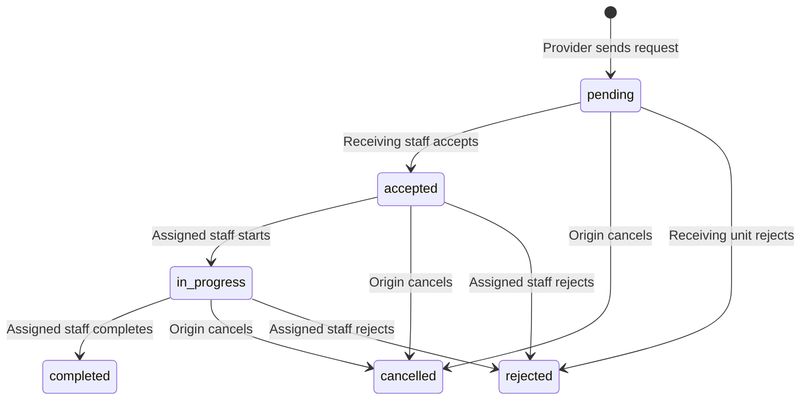

# Referral workflow (#20)

Referrals track hand-offs between medical, dental, and laboratory staff. They store only the request, task state, actor/time history, and completion reference. The server provides patient identity and the entered referral context. It does not provide unrelated charts.



Acceptance assigns the task to that staff member. Other members of the receiving unit have read-only access after assignment. Clinic head oversight adds read access, and does not add cross-author write access. Completed and closed tasks have no update or reopen operation. Create a new referral for further work.

Laboratory referrals require the originating provider's active order for the same patient. Completion requires the current finalized result from that exact order. The referral stores `labResultId`, and reads reference metadata from the laboratory records. It does not copy result values. A later laboratory correction is shown as a superseding reference, while the original completion reference stays unchanged. Referral closure and laboratory order closure are separate actions.

All new data are EDGE-only. The mirror whitelist stays unchanged.

## Public HTTP examples

Use the existing sign-in flow and synthetic records. Set `$headers` to the indicated staff role's Bearer token. UUIDs and revisions below come from server responses.

With the originating doctor:

```powershell
$clinicUrl = 'https://clinic.example'
$headers = @{ Authorization = "Bearer $token" }
$referral = Invoke-RestMethod "$clinicUrl/patients/$patientId/referrals" -Method Post -Headers $headers -ContentType 'application/json' -Body (@{ receivingDiscipline = 'dental'; reason = 'Synthetic dental assessment'; labOrderId = $null } | ConvertTo-Json)
Invoke-RestMethod "$clinicUrl/patients/$patientId/referrals" -Headers $headers
Invoke-RestMethod "$clinicUrl/referrals/sent?scope=all" -Headers $headers
```

With a dentist receiving the referral:

```powershell
Invoke-RestMethod "$clinicUrl/referrals/inbox?scope=pending" -Headers $headers
$referral = Invoke-RestMethod "$clinicUrl/referrals/$($referral.id)/accept" -Method Post -Headers $headers -ContentType 'application/json' -Body (@{ expectedRevision = $referral.revision } | ConvertTo-Json)
$referral = Invoke-RestMethod "$clinicUrl/referrals/$($referral.id)/start" -Method Post -Headers $headers -ContentType 'application/json' -Body (@{ expectedRevision = $referral.revision } | ConvertTo-Json)
$referral = Invoke-RestMethod "$clinicUrl/referrals/$($referral.id)/complete" -Method Post -Headers $headers -ContentType 'application/json' -Body (@{ expectedRevision = $referral.revision; completionNote = 'Synthetic assessment complete'; completionReference = 'Synthetic dental visit'; labResultId = $null } | ConvertTo-Json)
```

For separate active referrals, the origin can cancel, or the authorized receiver can reject:

```powershell
Invoke-RestMethod "$clinicUrl/referrals/$openReferralId/cancel" -Method Post -Headers $headers -ContentType 'application/json' -Body (@{ expectedRevision = $openReferralRevision; reason = 'No longer needed' } | ConvertTo-Json)
Invoke-RestMethod "$clinicUrl/referrals/$otherReferralId/reject" -Method Post -Headers $headers -ContentType 'application/json' -Body (@{ expectedRevision = $otherReferralRevision; reason = 'Clarify the requested task' } | ConvertTo-Json)
```

For a laboratory referral, the originating provider creates or selects their active order first:

```powershell
$referral = Invoke-RestMethod "$clinicUrl/patients/$patientId/referrals" -Method Post -Headers $headers -ContentType 'application/json' -Body (@{ receivingDiscipline = 'laboratory'; reason = 'Perform the ordered tests'; labOrderId = $labOrderId } | ConvertTo-Json)
```

The receiving medtech accepts and starts the task, then uses the laboratory workflow to finalize results. Completion links the final result:

```powershell
$referral = Invoke-RestMethod "$clinicUrl/referrals/$($referral.id)/complete" -Method Post -Headers $headers -ContentType 'application/json' -Body (@{ expectedRevision = $referral.revision; completionNote = $null; completionReference = $null; labResultId = $finalizedLabResultId } | ConvertTo-Json)
```

## Focused verification

Before new referral logic, the focused HTTP fixture failed because the referral controller did not exist. After implementation:

```text
pnpm --filter server exec vitest run --config vitest.e2e.config.mts test/referrals.e2e-spec.ts --reporter=json --outputFile=../docs/qa/referrals-http-evidence.json
```

The check uses the real feature controllers/services with a test-only in-memory database and principal guard. It verifies clerk denial, receiving-unit visibility, patient identity filtering, assignment ownership, stale revisions, dental acceptance/start/completion, preserved actor/time history, immutable completion, cancellation, rejection, same-patient laboratory linkage, missing-result rejection, and a full laboratory order/result finalization before referral completion. It checks that a referral returns a result reference without copied values.

The fixture does not verify PostgreSQL row locks or durable persistence, migration deployment, token authentication, or live desktop IPC. No existing database was migrated or reset. The laboratory schema, shared types, and service/controller copied into this checkout are frozen #16 prerequisites; integrate them from the #16 handoff, not twice.

## Interface review boundary

Scope: the patient referral form, receiving inbox, sent list, task detail, and completion/closure forms. Stack: existing React, clinic CSS tokens, Button/Input/Textarea, Field/Confirm, and Loading/Empty. Conventions: root AGENTS.md, CLAUDE.md, CONTEXT.md, and DESIGN.md.

| Domain        | Evidence inspected                                                           | Result                                                      |
| ------------- | ---------------------------------------------------------------------------- | ----------------------------------------------------------- |
| Accessibility | Referrals.tsx native controls, Field labels, Confirm, persistent live region | Source checked; keyboard/screen-reader runtime not verified |
| Layout        | referrals.css grid reflow, min-width, wrapping, flexible toolbars            | Source checked; rendered 320px and 200% zoom not verified   |
| Writing       | Form labels, ownership states, empty/error/recovery copy                     | Source checked                                              |
| Typography    | Existing system type; full IDs and notes wrap in details                     | Source checked; rendered measure not verified               |
| Colors        | Existing semantic tokens and textual status labels                           | Source checked; rendered contrast not verified              |
| UI            | Shared components and instant routine actions; no added motion               | Source checked; graphical states not verified               |

No new motion is proposed. Inbox navigation and routine task actions occur tens to hundreds of times daily, so extra movement was rejected. Clinical details must remain still while staff read them. Completion already uses the existing confirmation flow.

No actionable interface findings remain in inspected source. The static design detector returned no findings. This is not visual approval; rendered checks remain for the integrated app.
